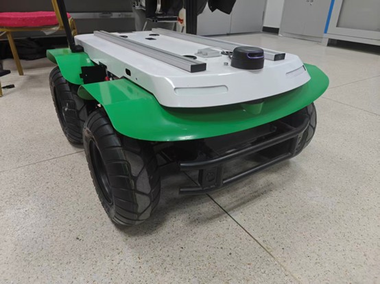
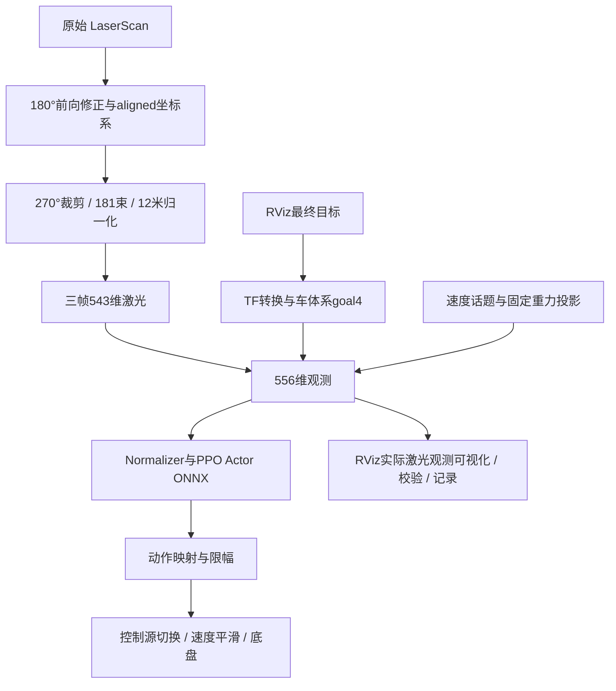
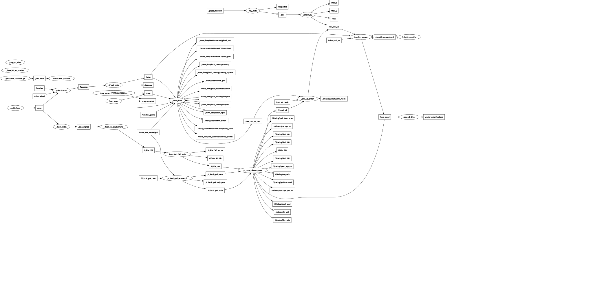

# Zeus S2 智能小车强化学习导航与 ROS1 实车部署

> ⚠️ **核心算法代码位于私有子模块 `core/`**（`hugh82617/zeus-s2-rl-navigation-private`，需授权访问）。本公开仓库仅保留文档、数据、媒体与实验记录；克隆后需先 `git submodule update --init --recursive` 并具备私有仓库访问权限，才能获取核心代码。

将 PPO 导航策略通过 ONNX Runtime 接入 Zeus S2 智能小车的 ROS1 感知与控制链路，完成激光观测构造、目标坐标变换、策略推理、动作处理及实车实验记录。项目同时包含 MATLAB / Simulink 路径跟踪、激光 SLAM 与传统导航实验，以及后续 `move_base` 局部规划器插件源码。

**平台主线：ROS1、Zeus S2、二维激光雷达、PPO、ONNX Runtime。** 已保存的4月28日实车RL快照运行于Ubuntu 18.04 / ROS Melodic；后续局部规划器插件以ROS Noetic为开发目标，不同阶段分别保留。

## 项目演示 · 视频1

https://github.com/user-attachments/assets/d4fc51cc-eefa-4091-9987-78dda76b44d4

毕业答辩目录中的“视频1”，时长38.88秒，保持原视频字节。播放器无法显示时，可[打开原始MP4](media/video1.mp4)。

[项目经历与问题解决](docs/project-journey.md) · [硬件配置](docs/hardware-platform.md) · [RViz工具链](docs/rviz-debugging.md) · [系统架构与节点图](docs/architecture.md) · [训练与部署](docs/training-and-deployment.md) · [MATLAB实验](docs/matlab-experiments.md) · [实验与数据](experiments/README.md) · [52段视频目录](media/README.md)

## 做了哪些工作

| 工作 | 实现与完成情况 | 直接查看 |
|---|---|---|
| PPO训练与ONNX导出 | 保存训练配置、检查点、194 / 556维模型；导出actor及观测normalizer | [训练快照](core/training/stage1/) · [导出脚本](core/models_and_export/RL-onnx/export_onnx.py) · [模型说明](core/models_and_export/README.md) |
| ROS1实车部署 | Python多节点组织感知、目标、ONNX推理与速度控制，保存实车运行材料 | [推理节点](core/ros1/python_nodes/rl_planner/scripts/rl_planner_node.py) · [4月28日运行记录](experiments/real_robot_2026-04-28/README.md) |
| 感知与观测对齐 | 修正雷达180°方向偏差、16米→12米归一化失配，构造181束及三帧543维激光观测 | [异常后退排查](docs/deployment-problem-cases.md#normalization-mismatch) · [180°修正](docs/deployment-problem-cases.md#lidar-frame-alignment) · [三帧节点](core/ros1/python_nodes/rl_planner/scripts/lidar_stack_543_node.py) |
| RViz诊断与实验记录 | 可视化策略实际181束观测，定位前方空间被低估的问题；建立输入与时序校验、修复统计及obs556日志工具链 | [完整工具链](docs/rviz-debugging.md) · [可视化节点](core/ros1/python_nodes/rl_planner/scripts/rl_obs0_181_rviz_node.py) · [记录器](core/ros1/python_nodes/rl_planner/scripts/experiment_logger_with_obs556.py) |
| MATLAB / Simulink控制 | 已进行Pure Pursuit路径跟踪与远程实车实验，包含到点判定、零速切换与停止仿真逻辑 | [实验说明](docs/matlab-experiments.md) · [MATLAB脚本](core/matlab/scripts/) · [Simulink模型](core/matlab/simulink/exp_6_2020b.slx) |
| 激光SLAM与传统导航 | 保留激光预处理、里程计与闭环代码、地图、导航配置及运行演示 | [SLAM与地图](core/slam/README.md) · [ROS1运行配置](core/ros1/runtime_reference/) |
| 全局路径接入与插件封装 | 实现C++ `nav_core::BaseLocalPlanner`插件、路径前瞻点与配置；该分支的构建和实车验证尚待完成 | [插件源码](core/ros1/local_planner_plugin/rl_planner/) · [版本与验证状态](docs/version-history.md) |

<details>
<summary>查看 Zeus S2 实车平台</summary>



[更多平台照片与实验记录](experiments/real_robot_2026-04-28/README.md)

</details>

## 实车硬件与系统配置

| 模块 | 型号或配置 | 关键参数 |
|---|---|---|
| 四驱移动平台 | **VSAI-FWD-B**，ROS软件采用Zeus S2命名 | 资料规格：912×710×410毫米，轴距500毫米、轮距555毫米 |
| 上位主控计算机 | **GK4000 Intel工控机，x86_64** | 实测可见内存约7.7GiB；根分区117G；枚举2个有线网络接口及Wi-Fi，USB2.0/3.0总线 |
| 二维激光雷达 | 清单标记**RPLIDAR A3M12** | 本次LaserScan声明0.15–16米、1440束；独立窗口13.315Hz，串口256000bps；A3系列厂商参考最远25米，条件及版本差异见详表 |
| IMU | **N100**，Type-C/串行接入 | 标称IMU数据400Hz、导航数据200Hz；本次`/imu/data`实测100.002Hz |
| 驱动电机与减速器 | 4台直流无刷电机 | 资料规格：4×600W、减速比1:40 |
| 光电编码器与里程计 | 每台驱动电机内置编码器 | 四台电机各有轮速测量；PPR/CPR及器件型号未保存，`/odom`输出约14Hz不能代替编码器采样率 |
| 底盘通信及外围 | `zeus_s2_driver`、USB-UART；枚举USBCAN/CANalyst-II设备 | 底盘串口参数115200bps；CAN总线速率和控制板具体型号未保存 |
| 电池与供电 | 锂电池、整机外供电及独立充电器 | 资料规格：48V/22Ah，外供24V/1A和12V/1A；车体有急停及总闸 |
| 超声波避障 | 资料列RS485模块 | 标称28–450厘米、声学载波40kHz；实际装机数量及测距更新率未确认 |
| 实车系统 | 4月28日快照：**Ubuntu 18.04系 / ROS1 Melodic** | 后续Noetic插件为另一开发阶段 |

完整的[硬件参数、接口及频率表](docs/hardware-parameters.md)分别标明厂商规格、驱动声明、实测窗口和策略参数，并附统计脚本。设备作用与来源见[硬件平台说明](docs/hardware-platform.md)。

## 强化学习如何接入小车



上图对应保存了实车运行材料的 **Python部署链路**。其中目标来自RViz最终目标，转换到车体系后进入策略；`/zeus_speed`在部分运行快照中可能是平滑命令，需按当次配置核对速度来源。

Stage3 观测为 `3线速度 + 3角速度 + 3重力 + 4目标 + 181×3激光 = 556维`。激光视场为 -135° 至 135°，按12m归一化，历史顺序为当前、上一帧、上上帧。Stage1另有194维模型，必须按配套配置使用。

**后续扩展：** C++插件通过 `move_base → setPlan() → 前瞻子目标 → ONNX → computeVelocityCommands()` 接入全局路径。该实现与上图分属不同阶段，构建与实车验证尚待完成；具体接口差异见[架构说明](docs/architecture.md)。

## RViz观测诊断工具链

围绕“策略实际看到了什么”建立诊断链路：从推理节点收到的激光中提取当前181束，按训练尺度恢复距离，在RViz中与原始扫描、车体和TF对照；结合三帧校验及完整日志追溯异常。

| 工具 | 检查内容 |
|---|---|
| RViz LaserScan / MarkerArray | 实际观测的空间分布、前方最近障碍距离及修复统计 |
| 观测一致性校验器 | 当前帧与543维堆叠的一致性、三帧时间顺序、坐标系和源时间戳 |
| 实验记录器 | 556维输入、目标、轨迹、动作与到达状态的关联记录 |

这套工具用于排查前方目标触发后退的16米/12米归一化失配。节点、话题、启动入口和RViz配置见[完整工具链说明](docs/rviz-debugging.md)。

<details>
<summary>查看实际ROS1节点与话题关系图（SVG）</summary>



[打开原始SVG并放大查看](docs/assets/rosgraph.svg)。图中展示激光、定位、RL推理、传统导航、控制切换与底盘连接；诊断工具的详细连接另见[RViz工具链](docs/rviz-debugging.md)。

</details>

## 遇到的问题与处理方法

| 问题 | 处理方法 | 完成情况与说明 |
|---|---|---|
| **激光雷达与车体前向相反约180°** | 扫描数组半周循环重排，发布`/scan_aligned`并配置配套TF，使障碍物方向与车体前向一致 | **已解决并用于ROS1实车链路**；[代码、TF与运行依据](docs/deployment-problem-cases.md#lidar-frame-alignment) |
| **前方设置目标却后退：训练与实车激光归一化失配** | 在RViz中按训练尺度重建策略实际181束观测，发现前方自由空间被低估；将部署端归一化分母由16米修正为12米 | **已定位并完成观测尺度对齐**；[现象、原因与排查过程](docs/deployment-problem-cases.md#normalization-mismatch) |
| **8×8米训练场景与较大实车实验场景不一致，策略出现绕远** | 分析场景泛化与缺少全局引导的问题，保留PPO/ONNX接口，完成全局路径前瞻子目标和ROS1插件适配源码 | 已形成源码原型；编译、输入等价及大场景效果待验证，见[场景差异处理](docs/deployment-problem-cases.md#scene-gap) |
| 无效测距与动态障碍观测波动 | 空间/时间修复、三帧堆叠、修复mask及时间戳诊断 | Python和C++滤波细节不同，逐帧等价仍需验证 |
| 目标附近绕行、震荡与动作偏差 | 保存目标门控、限速、bias及近目标规则版本，记录raw/clip/cmd | 规则包裹与模型重新训练应分别说明；并非所有方案都有同等验证 |
| 难定位异常来自输入还是控制 | 保存obs556、源beam映射、真值验证、轨迹和运行参数 | 话题间隔不能直接作为纯ONNX推理耗时 |
| MATLAB终点附近持续跟踪 | 保存到点判定、零速切换及停止仿真的模型实现 | 脚本与模型的四元数接口差异需在复跑时核对 |

坐标修正、异常后退排查、场景差异和输入接口的具体处理与证据见[关键部署问题详解](docs/deployment-problem-cases.md)。其他工作见[项目经历](docs/project-journey.md)、[MATLAB实验](docs/matlab-experiments.md)及[版本说明](docs/version-history.md)。

## 实验数据

对保存的四份 episode CSV 按 `outcome` 全量计数，每组900回合：

| 方法/数据批次 | 成功 | 碰撞 | 超时 | 成功率 |
|---|---:|---:|---:|---:|
| ESA_ON | 814 | 73 | 13 | 90.44% |
| ESA_OFF | 266 | 591 | 43 | 29.56% |
| DWA原版 | 124 | 229 | 547 | 13.78% |
| 0414对标ESA设置的DWA | 189 | 344 | 367 | 21.00% |

仓库附[统计脚本](core/experiments/analysis/analyze_episodes.py)、原始 CSV、75份实车 summary 和4月28日8次运行记录。论文初稿中还有另一组到达率，尚未建立数据批次与筛选口径的对应关系；实车 `success` 字段也不等于无碰撞成功。两版DWA分开保存，详细口径见[实验说明](experiments/README.md)。

在仓库根目录运行以下命令即可复核四组统计，只需Python标准库：

```bash
python core/experiments/analysis/analyze_episodes.py
```

## 全部实验视频

52段有效视频按强化学习部署、SLAM与自主导航、MATLAB控制、答辩演示和诊断分类，原视频不转码，仅对SHA256完全相同的文件去重。

| 分类 | 视频数 | 观看与下载 |
|---|---:|---|
| 强化学习部署与场景切片 | 27 | [6卷下载与合并](media/README.md#rl-video-parts) |
| 自主导航与SLAM系统素材 | 4 | [下载ZIP](https://github.com/hugh82617/zeus-s2-rl-navigation/releases/download/v1.0.0/video-navigation_slam-01.zip) |
| MATLAB控制导航 | 2 | [下载ZIP](https://github.com/hugh82617/zeus-s2-rl-navigation/releases/download/v1.0.0/video-matlab_control-01.zip) |
| 毕业答辩演示 | 6 | 本页视频1 + [其余5段](https://github.com/hugh82617/zeus-s2-rl-navigation/releases/download/v1.0.0/video-defense_demo-01.zip) |
| 诊断与对比剪辑 | 13 | [下载ZIP](https://github.com/hugh82617/zeus-s2-rl-navigation/releases/download/v1.0.0/video-diagnostics-01.zip) |

逐文件来源、剪辑关系和哈希见[视频目录](media/README.md)。Release的10项资产均已核对GitHub端大小与SHA256，详见[校验记录](provenance/release-assets.json)。

## 仓库结构

| 目录 | 内容 |
|---|---|
| `core/`（私有子模块） | 全部核心代码：ROS1 节点、move_base 插件、模型与 ONNX 导出、PPO 训练、SLAM、MATLAB、历史版本、工具脚本 |
| `experiments` | 仿真/实车数据、诊断记录（分析脚本在 `core/experiments`） |
| `docs`、`documents` | 技术说明、问题处理记录及原始项目文档 |
| `literature` | 相关论文书目与阅读笔记 |
| `media` | 首页视频1、分类清单及 Release 下载入口 |
| `provenance` | Release 资产校验记录 |

## 阅读与复现顺序

1. 先读[系统总览](docs/overview.md)和[项目经历](docs/project-journey.md)，区分实车部署与插件改造阶段。
2. 根据[模型与部署说明](docs/training-and-deployment.md)配对观测维度、normalizer、外置`.onnx.data`及动作参数。
3. 使用目标版本的ROS包、launch和真实硬件配置；归档中部分入口存在缺文件或版本差异，不能假定任意分支开箱即用。
4. 运行 `python core/experiments/analysis/analyze_episodes.py` 复核四组episode统计；这一检查无需ROS或模型推理。
5. 结合[视频清单](media/README.md)、原始运行日志和[验证边界](docs/limitations-and-validation.md)解释实验结果。

此次整理完成了文件复制哈希校验、模型接口核对、视频去重和数据重新计数，没有重新运行ROS、训练或驾驶小车。原有实验完成情况与本次复核范围分别记录。

相关代码保留原有版权和许可标识，第三方论文以[书目及阅读笔记](literature/README.md)引用。整理日期：2026-11-15。
