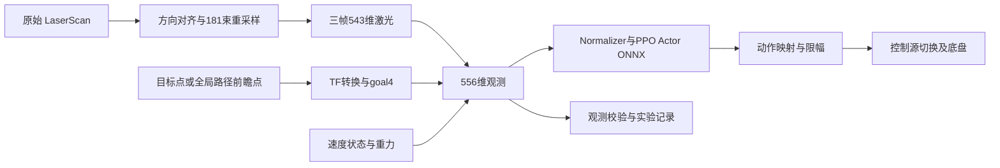

# Zeus S2 智能小车强化学习导航与 ROS1 实车部署

从 MATLAB / Simulink 路径跟踪、激光 SLAM 与自主导航，到 PPO 策略的 ONNX 导出、ROS1 真机部署和 `move_base` 局部规划器接入。本仓库按系统实现、问题处理、实验记录和演示视频整理这项工作，重点是强化学习策略如何进入真实小车的感知与控制闭环。

**平台主线：ROS1、Noetic、Zeus S2、二维激光雷达、PPO、ONNX Runtime。** 早期 MATLAB / Simulink 模型另保存 ROS Melodic 目标配置；不同阶段的配置按原记录保留。

[项目经历与问题解决](docs/project-journey.md) · [系统架构](docs/architecture.md) · [训练与部署](docs/training-and-deployment.md) · [实验与数据](experiments/README.md) · [全部视频目录](media/README.md)

## 演示与完成情况

**[观看或下载答辩“视频1”](media/video1.mp4)** · **[分类视频下载](https://github.com/hugh82617/zeus-s2-rl-navigation/releases/tag/v1.0.0)**

52段有效视频按强化学习部署、SLAM 与自主导航、MATLAB 控制、答辩演示和诊断分类。相同文件通过 SHA256 去重，原视频保留不转码；大体积视频放在 Release，仓库保留逐视频清单和来源对应关系。强化学习视频包分为6卷，附[校验与合并说明](media/README.md#rl-video-parts)。

| 工作 | 已完成的内容与保存证据 |
|---|---|
| MATLAB / Simulink 控制 | 已进行 Pure Pursuit 路径跟踪与远程实车控制实验，保存脚本、模型、实验记录及视频 |
| 激光 SLAM 与传统导航 | 保存激光预处理、里程计与闭环代码、地图、导航配置及运行演示 |
| PPO / ONNX 部署 | 保存训练快照、194 / 556 维模型、归一化导出代码、ROS 推理节点与实车运行记录 |
| 部署调试与数据采集 | 激光方向与尺度对齐、三帧观测、目标变换、输入真值检查、控制源切换、实验记录器 |
| 全局路径接入与插件封装 | 保存 C++ `nav_core::BaseLocalPlanner` 插件、路径前瞻点和配置；该分支的编译与实车验证尚待完成 |

## 强化学习如何接入小车

早期 Python 部署把 RViz 最终目标变换到车体系，策略直接输出二维动作；后续由 `move_base` 调用 C++ 局部规划器的 `setPlan()` 传入全局路径，再选择前瞻点。两者属于不同阶段，不能把早期实车运行记录当作后续插件已验证的证据。

Stage3 观测为 `3线速度 + 3角速度 + 3重力 + 4目标 + 181×3激光 = 556维`。激光视场为 -135° 至 135°，按12m归一化，历史顺序为当前、上一帧、上上帧。Stage1另有194维模型，必须按配套配置使用。

## 遇到的问题与处理方法

| 问题 | 已做的处理或形成的方案 | 需要保留的边界 |
|---|---|---|
| 真实雷达安装朝向与模型不同 | 半周索引对齐、270°裁剪、181束重采样，并在RViz核对 | 索引对齐与完整传感器外参不是同一件事 |
| 无效测距与动态障碍观测波动 | 空间/时间修复、三帧堆叠、修复mask及时间戳诊断 | Python和C++滤波细节不同，逐帧等价仍需验证 |
| 训练与部署输入尺度不一致 | 统一12m归一化、保留goal4的dz占位、随actor导出normalizer | 早期16m说明和194维旧版本仍可在归档中看到 |
| 小场景策略在大场景绕远 | 引入全局路径前瞻点，保留策略输入结构 | 聊天提出弧长方案；保存的C++按欧氏距离阈值选点 |
| 目标附近绕行、震荡与动作偏差 | 保存目标门控、限速、bias及近目标规则版本，记录raw/clip/cmd | 规则包裹与模型重新训练应分别说明；并非所有方案都有同等验证 |
| 难定位异常来自输入还是控制 | 保存obs556、源beam映射、真值验证、轨迹和运行参数 | 话题间隔不能直接作为纯ONNX推理耗时 |
| MATLAB终点附近持续跟踪 | 保存到点判定、零速切换及停止仿真的模型实现 | 脚本与模型的四元数接口差异需在复跑时核对 |

具体代码、参数、历史修订和原始证据见[项目经历](docs/project-journey.md)、[MATLAB实验](docs/matlab-experiments.md)及[版本说明](docs/version-history.md)。

## 实验数据

对保存的四份 episode CSV 按 `outcome` 全量计数，每组900回合：

| 方法/数据批次 | 成功 | 碰撞 | 超时 | 成功率 |
|---|---:|---:|---:|---:|
| ESA_ON | 814 | 73 | 13 | 90.44% |
| ESA_OFF | 266 | 591 | 43 | 29.56% |
| DWA原版 | 124 | 229 | 547 | 13.78% |
| 0414对标ESA设置的DWA | 189 | 344 | 367 | 21.00% |

仓库附[统计脚本](experiments/analysis/analyze_episodes.py)、原始 CSV、75份实车 summary 和4月28日8次运行记录。论文初稿中还有另一组到达率，尚未建立数据批次与筛选口径的对应关系；实车 `success` 字段也不等于无碰撞成功。两版DWA分开保存，详细口径见[实验说明](experiments/README.md)。

## 仓库结构

| 目录 | 内容 |
|---|---|
| `ros1/python_nodes/rl_planner` | 早期多节点实车部署包 |
| `ros1/local_planner_plugin/rl_planner` | C++ move_base 局部规划器插件源码 |
| `ros1/runtime_reference` | 真机导航参数、TF与话题参考快照 |
| `models_and_export` | 模型、外置权重、导出脚本及观测接口 |
| `training/stage1` | 训练代码与配置、代表性检查点及训练日志 |
| `experiments` | 仿真/实车数据、诊断和统计脚本 |
| `slam`、`matlab` | SLAM基础、地图、MATLAB与Simulink实验 |
| `docs`、`documents` | 技术说明、问题处理记录及原始项目文档 |
| `literature` | 相关论文书目与阅读笔记 |
| `media` | 指定视频1、分类视频清单及Release下载入口 |
| `archive` | 有实质差异的历史节点与插件版本 |

## 阅读与复现顺序

1. 先读[系统总览](docs/overview.md)和[项目经历](docs/project-journey.md)，区分实车部署与插件改造阶段。
2. 根据[模型与部署说明](docs/training-and-deployment.md)配对观测维度、normalizer、外置`.onnx.data`及动作参数。
3. 使用目标版本的ROS包、launch和真实硬件配置；归档中部分入口存在缺文件或版本差异，不能假定任意分支开箱即用。
4. 运行 `python experiments/analysis/analyze_episodes.py` 复核四组episode统计；这一检查无需ROS或模型推理。
5. 结合[视频清单](media/README.md)、原始运行日志和[验证边界](docs/limitations-and-validation.md)解释实验结果。

此次整理完成了文件复制哈希校验、模型接口核对、视频去重和数据重新计数，没有重新运行ROS、训练或驾驶小车。原有实验完成情况与本次复核范围分别记录。

相关代码保留原有版权和许可标识，第三方论文以[书目及阅读笔记](literature/README.md)引用。整理日期：2026-11-15。
