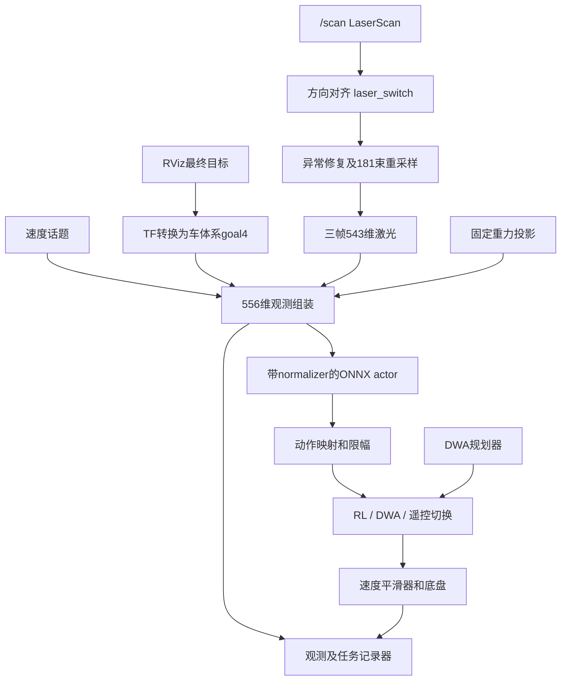
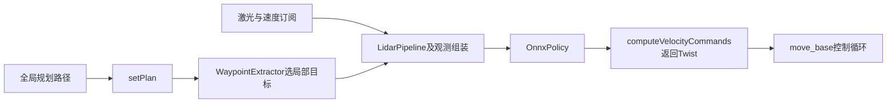

# 系统架构

项目包含两个主要导航实现阶段：多Python节点的实车部署链，以及接入 `move_base` 的C++局部规划器插件。两者的观测、滤波和到达逻辑有差异，按不同分支保留。

## 多节点实车部署

主要代码入口为 [`ros1/python_nodes/rl_planner`](../ros1/python_nodes/rl_planner/)。该包保存的 `rl_local_goal_provider.py` 直接订阅 `/move_base_simple/goal`，将最终目标转换到 `base_footprint`。在这个分支中，名字中的“local goal”表示车体系相对目标，并不自动表示来自全局路径的中间航点。

| 层 | 节点或话题 | 作用 |
|---|---|---|
| 方向对齐 | `laser_switch.py` → `/scan_aligned` | 半周索引重排，处理雷达安装朝向与模型车头方向的对应 |
| 单帧观测 | `lidar_obs_single_frame.py` → `/rl/lidar_181` | 米制空间异常修复、视场裁剪、线性重采样和12m归一化 |
| 激光历史 | `lidar_stack_543_node.py` → `/rl/lidar_543` | 以[t0,t1,t2]堆叠3帧，保存时间戳和修复信息 |
| 目标 | `rl_local_goal_provider.py` → `/rl_local_goal_body` | 输出车体系[dx,dy,dz,dyaw] |
| 推理 | `rl_planner_node.py` → `/rl_cmd_vel` | 组装556维，调用ONNX，执行分支对应的动作处理 |
| 控制源 | `cmd_vel_switch` | 选择RL、DWA或遥控，接入下游速度平滑与底盘链 |
| 记录与诊断 | `experiment_logger_with_obs556.py`、truth validator、RViz节点 | 保存目标、状态、速度、轨迹和模型实际输入 |

历史说明把 `/zeus_speed` 称作底盘反馈。4月28日保存的运行进程也出现 `velocity_smoother/smooth_cmd_vel:=zeus_speed`，因此不能仅按话题名认定它是独立硬件测量值；控制命令和硬件状态的来源须在目标部署系统中核对。

## C++局部规划器插件

插件入口为 [`ros1/local_planner_plugin/rl_planner`](../ros1/local_planner_plugin/rl_planner/)，类名 `rl_planner::RLLocalPlannerROS`，pluginlib名称 `rl_planner/RLLocalPlannerROS`。

插件实现 `initialize()`、`setPlan()`、`computeVelocityCommands()`、`isGoalReached()`。全局路径通过 `setPlan(std::vector<PoseStamped>)` 进入插件；导航栈可另以 `nav_msgs/Path` 发布路径，两种接口不要混写。

保存的C++选点实现从最近路径段或点之后，按路径点相对车体的**欧氏距离**达到lookahead阈值选取目标。历史讨论曾要求沿路径累计弧长；这项需求与保存的C++实现不同，不能按聊天描述认定代码已使用弧长。

接近终点时，部分C++版本把goal4的第四项改为最终目标的yaw误差，试图加入姿态到达条件。这改变了通常以目标方位角训练的输入语义；加入判断不等于策略已具备原地精确转正能力。

## 激光诊断与数据链

单帧节点包含源beam映射、repair mask和fill stats，三帧节点跟踪时间顺序和辅助消息配对。首帧用当前扫描填满三个槽，避免初始历史为空。Python版本对修复beam做三帧稳态处理；C++中位处理范围不同，不能默认两者逐帧等价。

记录器以 `map → base_footprint` 为轨迹基准。RL依据goal_reached、DWA依据当前goal_id的SUCCEEDED判定结束成功，并保存 `summary.txt` 与 `obs_556.txt`。这一success定义不包含完整的碰撞判定。
