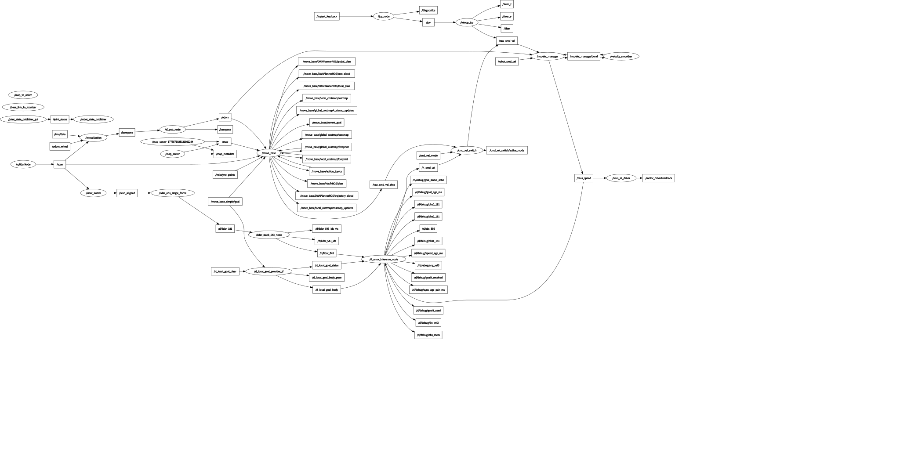
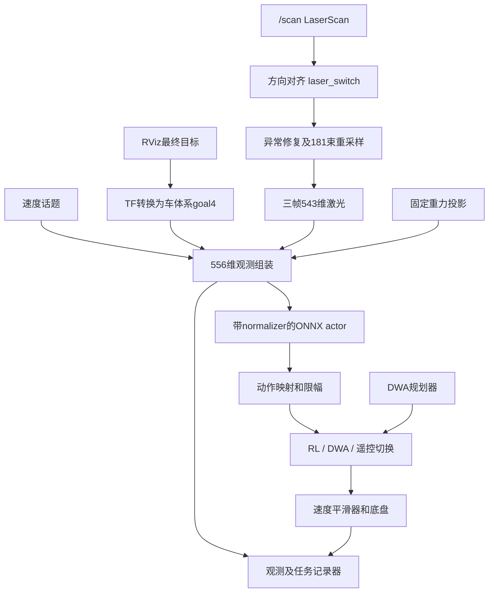
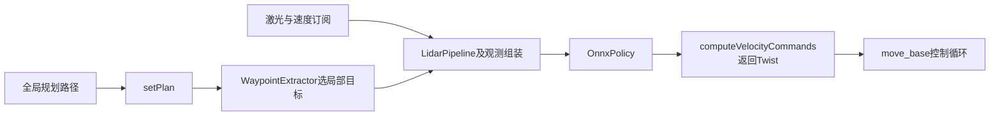

# 系统架构

项目包含两个主要导航实现阶段：多Python节点的实车部署链，以及接入 `move_base` 的C++局部规划器插件。两者的观测、滤波和到达逻辑有差异，按不同分支保留。

## 实际ROS节点与话题关系图

[打开原始SVG放大查看](assets/rosgraph.svg)。本图由项目作者补充，保留原始矢量文件；[来源与SHA256](../provenance/rosgraph-source.json)可供核对。

| 图中链路 | 含义 |
|---|---|
| `/rplidarNode → /scan → /laser_switch → /scan_aligned` | 雷达采集及前向修正 |
| 单帧预处理 → 三帧堆叠 → `/rl_onnx_inference_node` | 181/543维激光观测进入策略推理 |
| `/move_base_simple/goal → /rl_local_goal_provider_tf` | 最终目标转换为车体系目标后进入策略 |
| `/move_base`与`/cmd_vel_switch` | 传统导航、RL和遥控控制源的组织与切换 |
| 速度平滑 → `/zeus_speed → /zeus_s2_driver` | 控制命令进入底盘执行层 |
| `/imu/data`、`/odom_wheel → /relocalization → /laserpose → /tf_pub_node` | 状态估计、位姿与里程计发布链 |

图反映软件节点与话题连接，硬件型号和实际数据来源见[硬件平台](hardware-platform.md)。RViz实际观测可视化、三帧校验和日志的详细连接见[诊断工具链](rviz-debugging.md)。

## 多节点实车部署

主要代码入口为 [`ros1/python_nodes/rl_planner`](../ros1/python_nodes/rl_planner/)。该包保存的 `rl_local_goal_provider.py` 直接订阅 `/move_base_simple/goal`，将最终目标转换到 `base_footprint`。在这个分支中，名字中的“local goal”表示车体系相对目标，并不自动表示来自全局路径的中间航点。

| 层 | 节点或话题 | 作用 |
|---|---|---|
| 方向对齐 | `laser_switch.py` → `/scan_aligned` | 已解决雷达与车体前向相反约180°的问题：半周重排扫描，并配置`laser_link_aligned`的配套TF |
| 单帧观测 | `lidar_obs_single_frame.py` → `/rl/lidar_181` | 米制空间异常修复、视场裁剪、线性重采样和12m归一化 |
| 激光历史 | `lidar_stack_543_node.py` → `/rl/lidar_543` | 以[t0,t1,t2]堆叠3帧，保存时间戳和修复信息 |
| 目标 | `rl_local_goal_provider.py` → `/rl_local_goal_body` | 输出车体系[dx,dy,dz,dyaw] |
| 推理 | `rl_planner_node.py` → `/rl_cmd_vel` | 组装556维，调用ONNX，执行分支对应的动作处理 |
| 控制源 | `cmd_vel_switch` | 选择RL、DWA或遥控，接入下游速度平滑与底盘链 |
| 记录与诊断 | `experiment_logger_with_obs556.py`、truth validator、RViz节点 | 可视化实际181束观测，核对输入链路并保存目标、状态、速度、轨迹和obs556 |

180°方向修正先于视场裁剪和重采样；扫描数据重排与TF描述需要配套。归档中有两个aligned TF发布入口，部署时按当次TF树选用一个，不能重复发布或重复旋转。代码与实车运行依据见[坐标方向问题详解](deployment-problem-cases.md#lidar-frame-alignment)。

RViz诊断链路由推理节点发布`/rl/debug/obs0_181`，可视化节点将该当前帧按12米尺度恢复并重建LaserScan和MarkerArray。初次部署中，正是通过检查这一策略输入，发现16米部署归一化与12米训练尺度不一致、前方自由空间被低估的问题，随后修正预处理参数。完整过程见[前方目标触发后退的排查](deployment-problem-cases.md#normalization-mismatch)。

历史说明把 `/zeus_speed` 称作底盘反馈。4月28日保存的运行进程也出现 `velocity_smoother/smooth_cmd_vel:=zeus_speed`，因此不能仅按话题名认定它是独立硬件测量值；控制命令和硬件状态的来源须在目标部署系统中核对。

## C++局部规划器插件

插件入口为 [`ros1/local_planner_plugin/rl_planner`](../ros1/local_planner_plugin/rl_planner/)，类名 `rl_planner::RLLocalPlannerROS`，pluginlib名称 `rl_planner/RLLocalPlannerROS`。

这一扩展针对8×8米训练场景与较大实验环境不一致、直接追最终目标容易绕远的问题，引入全局路径前瞻子目标。它与12米激光归一化的输入对齐是不同层次的处理；源码已保存，尚未完成真实编译和大场景效果验证，详见[场景差异处理](deployment-problem-cases.md#scene-gap)。

插件实现 `initialize()`、`setPlan()`、`computeVelocityCommands()`、`isGoalReached()`。全局路径通过 `setPlan(std::vector<PoseStamped>)` 进入插件；导航栈可另以 `nav_msgs/Path` 发布路径，两种接口不要混写。

保存的C++选点实现从最近路径段或点之后，按路径点相对车体的**欧氏距离**达到lookahead阈值选取目标。历史讨论曾要求沿路径累计弧长；这项需求与保存的C++实现不同，不能按聊天描述认定代码已使用弧长。

接近终点时，部分C++版本把goal4的第四项改为最终目标的yaw误差，试图加入姿态到达条件。这改变了通常以目标方位角训练的输入语义；加入判断不等于策略已具备原地精确转正能力。

## 激光诊断与数据链

单帧节点包含源beam映射、repair mask和fill stats，三帧节点跟踪时间顺序和辅助消息配对。首帧用当前扫描填满三个槽，避免初始历史为空。Python版本对修复beam做三帧稳态处理；C++中位处理范围不同，不能默认两者逐帧等价。

记录器以 `map → base_footprint` 为轨迹基准。RL依据goal_reached、DWA依据当前goal_id的SUCCEEDED判定结束成功，并保存 `summary.txt` 与 `obs_556.txt`。这一success定义不包含完整的碰撞判定。
