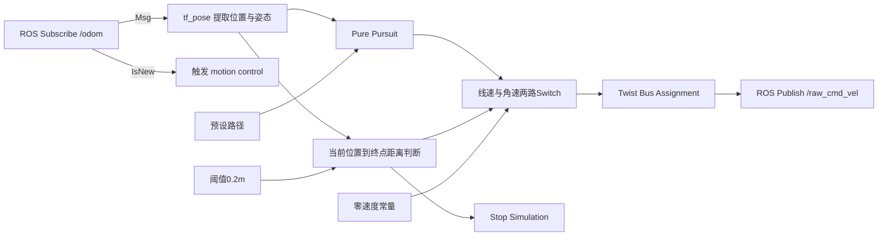

# MATLAB路径跟踪与Simulink实车控制

在强化学习策略部署之前，我已完成ROS1基础通信与小车调试、MATLAB远程控制、Pure Pursuit路径跟踪和Simulink联合ROS实车控制。这部分工作有程序、SLX模型、实验记录和运行附件支撑，也是后续将强化学习策略接入真实机器人时的控制与通信基础。

本说明根据保存的《工作汇报》《1-实验记录》《6-代码阅读》、三个MATLAB脚本和SLX内部XML整理。以下“完成”指原来的实验工作；此次仓库整理没有重新启动MATLAB、仿真或实车，因此不会把整理过程写成一次新的性能测试。

## 一 从ROS通信到实车控制

首先完成ROS基本操作与系统认知：用rostopic查询、订阅和发布消息，用rosservice完成单次调用，用turtlesim mimic观察第二只小乌龟跟随第一只运动；再用rqt_graph和TF树检查节点、话题及坐标关系。随后在小车上完成地图构建、RViz显示和导航/避障操作。

MATLAB实验将这些能力连接为实际控制闭环：MATLAB加入小车的ROS Master，接收机器人位姿，计算控制输出，再通过底盘速度话题驱动真实小车。脚本设置ROS_MASTER_URI，建立/raw_cmd_vel发布者和/odom订阅者，而非只在MATLAB内部积分虚拟机器人。

| 已完成的环节 | 保存实现 | 具体工作 |
|---|---|---|
| ROS网络连接 | rosinit、ROS_MASTER_URI和机器人侧网络配置 | PC与ROS Master通信，MATLAB加入ROS系统 |
| 雷达数据读取 | [test2.m](../matlab/scripts/test2.m) | /scan→测距/扫描角→lidarScan→绘制扫描 |
| 栅格地图读取 | [test3.m](../matlab/scripts/test3.m) | /map→OccupancyGrid读取→地图显示 |
| 实车路径跟踪 | [test1.m](../matlab/scripts/test1.m) | /odom位姿反馈→Pure Pursuit→速度消息→/raw_cmd_vel |
| Simulink实车联调 | [SLX模型](../matlab/simulink/exp_6_2020b.slx) | 消息触发、姿态转换、路径跟踪、到点判断和速度门控 |

实验记录明确描述机器人能够按照预设路径稳定运动，同时记录了接近终点仍绕行的问题。本阶段成果是把真实控制链路跑通，并对终点行为进行分析和处理；不补造资料中不存在的跟踪误差和成功率。

## 二 MATLAB程序具体做了什么

test1的闭环按以下顺序运行：初始化ROS发布者/订阅者；定义waypoints、终点和Pure Pursuit参数；按当前[x,y,heading]计算v和omega，写入Twist的Linear.X、Angular.Z；接收/odom位置与四元数并更新位姿；重新计算终点距离；绘制路径和机器人姿态；满足目标距离条件后发零速并关闭ROS连接。

脚本创建了differentialDriveKinematics对象，但derivative和数值积分两行已注释；实际循环使用`receive(odomsub,10)`得到的位姿。因此它承担的是ROS实车闭环控制，不能仅凭差速运动学对象就写成完成了独立仿真验证。

| 参数 | MATLAB脚本test1 | Simulink模型 |
|---|---|---|
| 路径 | [0,0]→[-2,0]→[-2,1] | [0,0]→[-3,0]→[-3,2.8] |
| 期望线速度 | 0.2m/s | 0.2m/s |
| 最大角速度 | 0.3rad/s | 0.3rad/s |
| 前瞻距离 | 0.3m | 0.3m |
| 到点距离阈值 | goalRadius=0.2m | err=0.2m |
| 时基设置 | sampleTime=0.02s | FixedStep=0.02s |
| 控制输入 | /odom | /odom的IsNew触发 |
| 控制输出 | /raw_cmd_vel | /raw_cmd_vel |

脚本保存WheelRadius=0.1525m、TrackWidth=0.71m；它们是早期程序值，不应直接替换后续训练模型的轮距参数。由于receive会等待里程计，0.02s是设置的节拍，不是这次整理重新测得的50Hz闭环频率。

## 三 Simulink如何构成闭环

图对应保存模型的块和连线。Subscribe的Msg接motion control输入，IsNew接触发端。tf_pose提取x、y、四元数，经过ZYX转换构成[x,y,yaw]；Pure Pursuit根据位姿与路径输出v、omega。Blank Message提供Twist总线，Bus Assignment写入Linear.X和Angular.Z，再由Publish发送。

模型的MATLAB Function计算当前位置到[-3,2.8]的平面距离，小于err时令arrived=1。arrived同时连接两路Switch和Stop Simulation；Switch的一个输入为零速度，另一个为控制器速度。这使到点处理成为显式控制逻辑，而非只停止画图。

保存模型的Robot Visualizer块被Commented on，不能据其存在认定当前模型已启用该可视化路径。模型还保存了C++代码生成和Robot Operating System (ROS)目标设置。文件名虽含2020b，实际保存元数据为R2022b，ROS安装路径含melodic；这些是早期ROS1环境信息，后续Noetic部署应单独配置。

## 四 遇到的问题及处理

### 地图导出时Cairo图像格式断言失败

实验遇到Cartographer的pbstream转ROS栅格地图时，Cairo surface格式校验返回无效值并触发CHECK失败。记录将排查方向指向可用于生成二维概率栅格的有效submap不足。

采用的处理方法是在保存前让机器人继续运动，包含直行和转向，使激光充分覆盖环境；在RViz观察到连续完整的二维栅格结构、形成足够有效submap后，再执行pbstream导出与地图转换。这个过程也明确了有效地图采集与MATLAB读取/map之间的前置关系。

这里保留当时的报错、分析和处理步骤，不将submap不足推广为该类Cairo错误在所有环境中的唯一原因。

### 目标附近持续绕行

记录保留一次路径[0,0]→[-2,0]→[-2,1]、线速度0.2、角速度设置0.3、前瞻0.01的尝试：机器人能跟踪路径，但接近终点仍沿小圆弧运动。记录也明确，调小前瞻、加入距离阈值并不自动保证所有情况下正确停车。

已完成的分析是将Pure Pursuit曲率跟踪与到点控制分开：当控制器仍给正线速度时，机器人会继续沿对应曲率的圆弧运动；绕行半径不能简单等同于人为设置的目标距离阈值。过小前瞻还会放大转向变化，引发抖动。

程序的处理包括独立计算distanceToGoal、使用目标半径终止循环并发零速；保存的Simulink模型进一步将独立arrived判断接入两路速度Switch和停止模块。最终快照中LookaheadDistance为0.3m、到点阈值0.2m。资料未给出同场景前后误差统计，因此准确描述所做的停车逻辑和调参，不声称所有工况的绕行都已彻底消除。

### 姿态和消息结构转换

ROS Odometry提供位置与四元数，控制器需要[x,y,yaw]，速度又要按Twist层级组织。已完成四元数/欧拉角学习、tf_pose和ROS Bus映射，记录还讨论了欧拉角万向节锁。这项工作同时处理控制输入语义、消息字段和坐标约定。

保存版本间存在接口差异：test1按[X,Y,Z,W]排列四元数传入quat2angle并取第三返回；Simulink的tf_pose按[W,X,Y,Z]组装，ZYX转换后取第一分量作为平面朝向。重新使用归档代码应按函数版本核对，不能默认两个快照语义相同。此次整理没有修改原程序，也不把静态差异写成已完成的新修复。

### 感知输入质量和计算开销

同期工作完成了激光坐标转换、离群点剔除和降采样，在ROS节点订阅/scan、处理并发布/process_scan，记录时间用于性能分析。工作汇报保存两组体素尺度/半径滤波半径/最少邻居数：0.5/0.5/5与0.1/0.3/3。

记录观察到更细尺度能保留更多环境细节，也会增加点数与计算开销，且单靠减小参数不能消除离群噪声。《6-代码阅读》进一步梳理catkin/PCL节点、滤波回调、ICP、关键帧、闭环与图优化。对应代码见[SLAM目录](../slam/)。这部分为地图、定位及后续强化学习激光输入对齐提供基础。

## 五 与后续强化学习部署的衔接

MATLAB阶段已打通“位姿接收—控制决策—速度发布—实车反馈—终点停车”链路。后续RL阶段沿用ROS1消息与底盘接口，将Pure Pursuit决策扩展为基于激光、目标和速度的ONNX推理，再处理多帧观测、归一化、方向对齐、时序一致性、动作映射和DWA/RL切换。

两阶段的关联是实车接口与调试能力积累；MATLAB路径跟踪不替代RL算法性能证据。900回合CSV、75份实车summary和4月28日8次trial是另外的实验记录，见[实验目录](../experiments/README.md)。

## 六 归档复用

- 需具备提供rosinit、rospublisher、rossubscriber、controllerPurePursuit、differentialDriveKinematics、quat2angle等函数的MATLAB工具箱；按实际版本的which和许可信息核对依赖。
- 原脚本含当次ROS Master地址，模型含melodic目标配置；复用前按实际网络与ROS1发行版调整。
- test1的groundvehicle.stl用于显示，不在保存的三个手写脚本中，需确认本机工具箱示例资源或使用自己的显示资源。
- 修改模型waypoints时，同时检查MATLAB Function固定终点[-3,2.8]，避免停车目标与最后路径点不一致。
- build_ros_model.sh面向导出的tgz和有效catkin工作空间，不是直接启动SLX的脚本；文件有覆盖目标包目录的操作，使用前应明确工作空间和包名。

手写脚本和SLX已保留，slprj、ert_rtw、slxc与自动Bus缓存没有作为额外成果加入。到点函数和消息字段嵌入SLX，所检查XML没有引用另一个必须补拷的外部手写.m。模型检查结果见[model-inspection.json](../matlab/simulink/model-inspection.json)。

原始资料相对于知识库根：工作总结-2026.1.18下的工作汇报.docx、1-实验记录/1-实验记录.docx、6-代码阅读/6-代码阅读.docx，以及5-MATLAB程序及Simulink模型。参数和结果均按各自快照解释。
