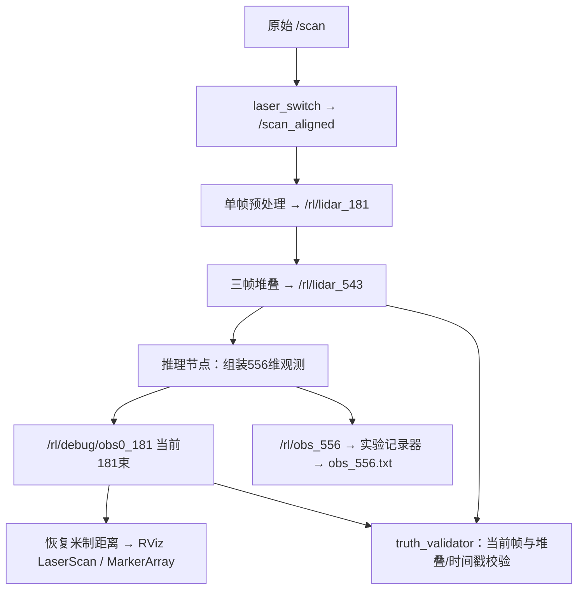

# RViz观测可视化、链路校验与实验日志

这套工具用于回答“策略实际收到了什么观测，异常从哪一级开始”。它服务于已保存实车运行材料的Python部署链路：RViz显示空间结构，校验器检查数据传递与时序，记录器保存完整观测和实验过程，三者相互补充。

整机传感器与处理平台见[硬件配置](hardware-platform.md)，作者补充的实际ROS运行节点图见[系统架构](architecture.md)。

## 1 数据从雷达到策略，再到诊断工具



| 环节与源码 | 输入/输出 | 诊断作用 |
|---|---|---|
| [方向修正](../ros1/python_nodes/rl_planner/scripts/laser_switch.py) | `/scan` → `/scan_aligned` | 半周循环重排；配套`laser_link_aligned` TF表达修正后的前向 |
| [单帧预处理](../ros1/python_nodes/rl_planner/scripts/lidar_obs_single_frame.py) | aligned扫描 → `/rl/lidar_181` | 270°、181束、12米归一化；另发源beam映射、修复mask/统计及源时间戳 |
| [三帧堆叠](../ros1/python_nodes/rl_planner/scripts/lidar_stack_543_node.py) | 181 → `/rl/lidar_543` | 保存当前/上一帧/上上帧；`/rl/lidar_543_stamps`记录三帧源时间，另有帧ID诊断 |
| [推理节点](../ros1/python_nodes/rl_planner/scripts/rl_planner_node.py) | 543及速度/目标 → 556 | 从收到的激光输入提取`obs0_181`、`obs1_181`、`obs2_181`；发布`/rl/obs_556` |
| [RViz观测节点](../ros1/python_nodes/rl_planner/scripts/rl_obs0_181_rviz_node.py) | `/rl/debug/obs0_181` → scan/markers | 将当前帧恢复为米制空间，检查策略输入中的距离与方向 |
| [一致性校验器](../ros1/python_nodes/rl_planner/scripts/rl_obs0_truth_validator.py) | obs0、543、三帧时间戳、单帧Header | 检查值、时间顺序、frame及源时间戳，写入CSV格式检查文件 |
| [实验记录器](../ros1/python_nodes/rl_planner/scripts/experiment_logger_with_obs556.py) | `/rl/obs_556`及目标/状态/速度/位姿 | 在活动实验内写`obs_556.txt`，关联轨迹与到达状态，支持事后追查 |

`obs0_181`是推理节点收到的543维激光中的首181维，而不是另订阅一次原始雷达重算的显示。推理节点需启用`debug_publish_inputs`；完整观测发布由`publish_obs`控制，现有推理launch中两者均为true。观测发布还受目标有效性与控制循环状态影响。

## 2 RViz具体显示什么

可视化节点按`restore_scale=12.0`将归一化值恢复为显示距离，用−135°至135°生成181束`LaserScan`及二维点集，输出坐标系为`laser_link_aligned`。

| RViz显示类型 | 话题 | 显示内容 |
|---|---|---|
| LaserScan | `/scan` | 原始扫描，用作实际测量参照 |
| LaserScan | `/rl/debug/obs0_181_scan_vis` | 策略当前帧恢复后的扫描 |
| MarkerArray | `/rl/debug/obs0_181_markers_vis` | 点集、全局最近点、前方最近点；文字给出距离、恢复尺度及修复数量/比例 |
| TF / RobotModel | TF树、robot_description | 对照车头、雷达原始frame和aligned frame的方向关系 |

[保存的RViz配置](../ros1/python_nodes/rl_planner/Rviz/local_goal_debug.rviz)已包含以上主要显示及地图、全局路径、目标和轨迹，Fixed Frame为`map`。局部观察可按实际TF树选`laser_link_aligned`；在`map`中叠加显示需要相应TF链。配置还保留前瞻点等历史显示项，无对应发布节点时不会显示，不能据此判断插件已运行。

这里的`restore_scale`控制恢复比例；保存的可视化launch把`max_distance`设为16米，它只控制显示量程/限幅，不等于策略仍按16米归一化。Marker文字显示修复统计，不对每束修复位置单独着色。

## 3 用它定位过哪些问题

**前方目标却后退。** 初次部署时，训练与部署的距离归一化不一致，前方自由空间在策略输入中显得过窄。将当前181束按训练尺度恢复并与RViz中的实际障碍分布对照后，沿预处理链定位到16米/12米尺度差异，最终将部署端修正为12米。对未触及截断的同一测距，`r/16`仅为`r/12`的75%。恢复显示用于诊断，真正修正推理输入的是预处理参数；完整经过见[异常后退排查](deployment-problem-cases.md#normalization-mismatch)。

**雷达前向与车头相反180°。** 对照原始扫描、恢复后的观测、车体和TF，检查真实前方障碍是否对应输入前方。处理包含扫描半周循环重排及配套aligned TF，不能把数组倒序当作半周旋转，也不能让两个入口同时发布同一aligned child。实车链路已采用修正，依据见[方向对齐案例](deployment-problem-cases.md#lidar-frame-alignment)。

**三帧错序或观测传递异常。** 校验器比较obs0与543维首181维，默认逐元素容差`1e-6`；检查`t0 ≥ t1 ≥ t2`、Header的`laser_link_aligned`及Header源时间与t0的差异。它按接收时间邻近匹配缓存，默认窗口0.20秒，出现不匹配时需结合源时间和队列排查；结果是链路一致性检查，不是独立物理距离真值或严格逐消息同步证明。

检查结果默认写入`~/rl_obs0_truth_check.txt`，含最大差值、失配束数、匹配状态及时间/frame字段；[汇总脚本](../ros1/python_nodes/rl_planner/scripts/summarize_rl_obs0_truth_check.py)可生成摘要。实验记录器另按目标生命周期保存完整556维输入；启动记录器后还需满足活动模式、有效目标及记录状态，不能将“节点已启动”当作已生成有效实验日志。

## 4 已保存的启动入口

以下是已存在的**诊断入口**，在ROS1工作空间中配置好`rl_planner`、依赖、TF及上游数据后，分别在终端运行；它们不会自动启动完整推理链或底盘：

```bash
roslaunch rl_planner rl_obs0_181_rviz.launch
roslaunch rl_planner rl_obs0_truth_validator.launch
roslaunch rl_planner experiment_logger_with_obs556.launch
rviz -d "$(rospack find rl_planner)/Rviz/local_goal_debug.rviz"
```

[可视化launch](../ros1/python_nodes/rl_planner/launch/rl_obs0_181_rviz.launch)自带`laser_link → laser_link_aligned`的π旋转TF，不启动RViz窗口。若已使用[laser_switch.launch](../ros1/python_nodes/rl_planner/launch/laser_switch.launch)发布aligned TF，应保留已有正确TF，改为仅启动可视化节点：

```bash
rosrun rl_planner rl_obs0_181_rviz_node.py _restore_scale:=12.0
```

[校验launch](../ros1/python_nodes/rl_planner/launch/rl_obs0_truth_validator.launch)与[记录launch](../ros1/python_nodes/rl_planner/launch/experiment_logger_with_obs556.launch)均引用现有脚本；记录launch保存目录为`/home/ros/save_dir`，需按目标系统调整。上面两种可视化入口择一使用。

上游入口仍须按版本核对：现有`lidar_obs_single_frame.launch`引用未保存在该脚本目录中的`lidar_obs_single_frame(2).py`，且该launch目录未保存543堆叠启动文件；推理launch还含真机模型绝对路径。因此这里展示可核对的工具链和诊断命令，不宣称仓库已具备整链一键运行能力。模型配对与其他限制见[训练与部署接口](training-and-deployment.md)、[版本记录](version-history.md)。
